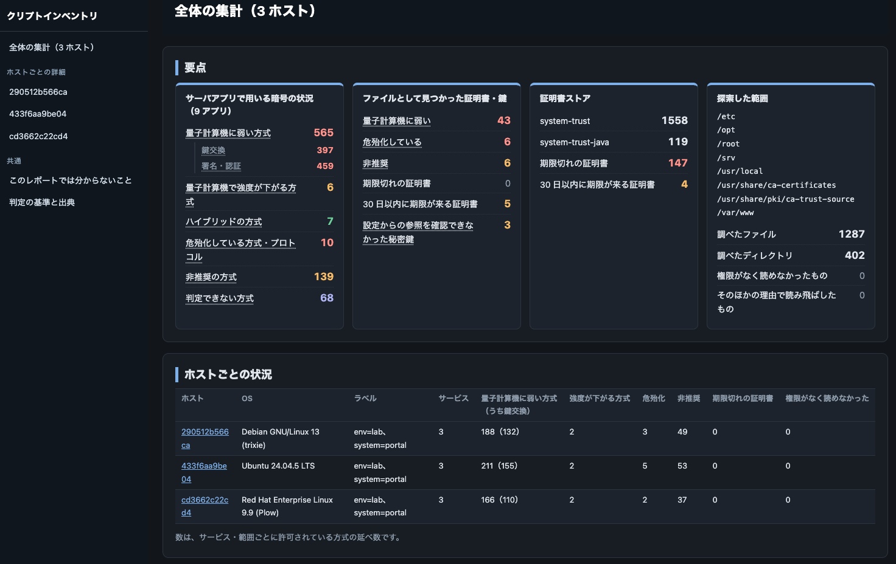
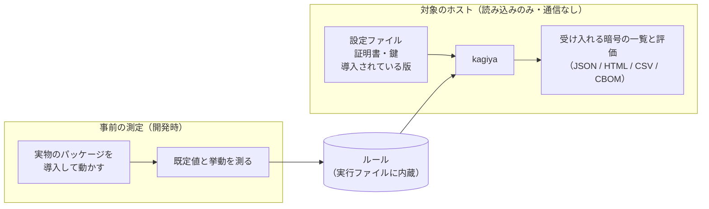

# kagiya

耐量子計算機暗号（PQC）への移行に向けて、暗号を棚卸しするツールです。 実行したホストのファイルを読むだけで、動的スキャン等通信は切行いません。

結果は単一のhtmlファイルにすることができます。[サンプル画面](https://moratori.github.io/kagiya/)



## 入手

[Releases](../../releases) から、実行環境のアーキテクチャに合う実行ファイルを取得ください。

## 使い方

棚卸し対象のシステムで、本ツールを動作させてください。

```sh
# スキャン結果を out フォルダに書き出します（ログは out/logs に書かれます）
# 出力先は、探索するディレクトリ（--roots）と同じ場所や、その上位には指定できません
./kagiya scan --output-dir out

# HTML のレポートを作る
./kagiya report --output-dir report out/kagiya-*.json

# CSV、または CBOM（CycloneDX 1.6）に変換する
./kagiya convert --to csv  --output-dir out out/kagiya-<ホスト名>-<日時>-<ID>.json
./kagiya convert --to cbom --output-dir out out/kagiya-<ホスト名>-<日時>-<ID>.json
```

| オプション | 内容 |
|---|---|
| `--roots` | 証明書や鍵を探すディレクトリ。既定は `/etc`、`/opt`、`/usr/local`、`/srv`、`/var/www`、`/root` |
| `--exclude` | 除外するパスのパターン |
| `--label key=value` | 結果に付けるラベル（システム名など） |
| `--cpu-limit` / `--io-limit` | 負荷の上限。既定は CPU 25%、読み取り 20 MiB/秒 |
| `--max-duration` | 指定した時間で打ち切る |

## 仕組み



### なぜ判定できるのか

サーバーが受け入れる暗号は、「設定ファイルに書かれた値」と「書かれていない場合のデフォルト値」、そして「ソフトウェアによる解釈」で決まります。
設定ファイルはホストにありますが、既定値と解釈はソフトウェアの中にあり、ディストリビューションのパッケージの版ごとに違います。

kagiya は、この既定値と解釈を事前に測ってルールとして持っています。
ホストでは、設定ファイルと導入されているパッケージの版を読み、その版のルールを当てはめることで、サーバーを動かしたり接続したりせずに、受け入れる暗号の一覧を求めます。

### 事前の測定とは

ディストリビューションの公式イメージに実際のパッケージを導入してサーバーを起動し、次のことを確かめる作業です。
本ツール開発者の環境で既に行なっています。

- 設定に書かれていない項目の既定値
- 設定の書き方と、実際にサーバーが受け入れる暗号との対応

### 測定していない環境で動かした場合

パッケージの版は、`1.1.1k-18.el8_6` のように 2 つの部分からできています。

- `-` の前（`1.1.1k`）は、ソフトウェアの開発元が付けた版です。以下「開発元の版」と呼びます
- `-` の後（`18.el8_6`）は、ディストリビューションがそのパッケージを作り直すたびに進める番号（`18`）と、ディストリビューションの系列（`el8`）です。修正の適用などで番号だけが進みます

| 環境 | 結果 |
|---|---|
| 測定したパッケージと、開発元の版もディストリビューションの系列も同じで、作り直しの番号だけが違う（測定したのが `1.1.1k-18.el8_6` で、ホストにあるのが `1.1.1k-14.el8_6` の場合など） | 測定したパッケージの表で補います。確度を下げ、補ったことを結果に記録します |
| 開発元の版が違う、またはディストリビューションの系列が違う | 受け入れる暗号の一覧は推測せず「不明」とします |
| ルールにないソフトウェア | そのソフトウェアの設定は読みません。証明書や鍵は、ファイルとして見つかれば記録します |

ファイルとして置かれた証明書・鍵・キーストアの検出と評価は、事前の測定によらず、どの環境でも同じように行います。

## ユースケース

### 多数のサーバーの結果を、Ansible で管理サーバーに集める

kagiya は 1 台のホストの中だけを見るツールなので、複数のサーバーを棚卸しするには、各サーバーで実行して結果を持ち寄ります。
Ansible を使うと、「実行ファイルを配る → スキャンする → 結果を管理サーバーに集める」を、まとめて行えます。

管理サーバー（Ansible を実行するマシン）に、次の 3 つを置きます。プレイブックとインベントリの例は [examples/ansible/](examples/ansible/) にあります。

```
kagiya.yml        プレイブック（下記）
inventory.ini     対象のサーバーの一覧
files/kagiya      kagiya の実行ファイル（対象のサーバーの OS・CPU 向けのもの）
```

`inventory.ini`:

```ini
# 対象のサーバー。接続のしかた（利用者、鍵など）は、環境に合わせて書く
[servers]
web01.example.jp
db01.example.jp
```

`kagiya.yml`:

```yaml
- name: kagiya でクリプトインベントリを作り、管理サーバーに集める
  hosts: all
  become: true          # 鍵や設定を読むため、root で実行する
  gather_facts: false
  vars:
    kagiya_binary: files/kagiya              # 管理サーバー上の実行ファイル
    kagiya_dir: /opt/kagiya                  # サーバー上の置き場
    kagiya_output_dir: /var/lib/kagiya/out   # サーバー上の出力先（探索するディレクトリの外に置く）
    collect_dir: "{{ playbook_dir }}/results"  # 管理サーバー上の集め先

  tasks:
    - name: 集め先を作る（管理サーバー側。結果は機密なので、作成者だけが読めるようにする）
      ansible.builtin.file:
        path: "{{ collect_dir }}"
        state: directory
        mode: "0700"
      delegate_to: localhost
      become: false
      run_once: true

    - name: 置き場と出力先を作る
      ansible.builtin.file:
        path: "{{ item }}"
        state: directory
        owner: root
        group: root
        mode: "0700"
      loop:
        - "{{ kagiya_dir }}"
        - "{{ kagiya_output_dir }}"

    - name: 実行ファイルを置く
      ansible.builtin.copy:
        src: "{{ kagiya_binary }}"
        dest: "{{ kagiya_dir }}/kagiya"
        owner: root
        group: root
        mode: "0755"

    - name: スキャンする（読み取りだけ。通信はしない）
      ansible.builtin.command:
        argv:
          - "{{ kagiya_dir }}/kagiya"
          - scan
          - --output-dir
          - "{{ kagiya_output_dir }}"
          - --max-duration
          - 30m
          - --label
          - "inventory_hostname={{ inventory_hostname }}"
      changed_when: true

    - name: 結果のファイルを探す
      ansible.builtin.find:
        paths: "{{ kagiya_output_dir }}"
        patterns: "kagiya-*.json"
      register: kagiya_results

    - name: 結果を管理サーバーに集める
      ansible.builtin.fetch:
        src: "{{ item.path }}"
        dest: "{{ collect_dir }}/{{ inventory_hostname }}/"
        flat: true
      loop: "{{ kagiya_results.files }}"
      loop_control:
        label: "{{ item.path | basename }}"

    - name: 集め終えた結果を、サーバーから消す
      ansible.builtin.file:
        path: "{{ item.path }}"
        state: absent
      loop: "{{ kagiya_results.files }}"
      loop_control:
        label: "{{ item.path | basename }}"
```

実行します。

```sh
ansible-playbook -i inventory.ini kagiya.yml

# 集まった結果から、全サーバーをまとめたレポートを作る（管理サーバーの OS 向けの kagiya で）
kagiya report --output-dir report results/*/*.json
```

結果は、管理サーバーの `results/<サーバー名>/` に集まります。実行のたびに別の名前のファイルが増え、前の結果は上書きしません。

- サーバー上の出力先（`kagiya_output_dir`）は、kagiya 専用のディレクトリにしてください。プレイブックが、作成者だけが読める権限（0700）にします
- 集めた結果には、鍵や証明書の場所などが含まれます。管理サーバーでも、機密として扱ってください

## 注意

- 分かるのは「受け入れる設定になっている」暗号までです。実際の通信でどれが使われているかは分かりません
- このツールで分からないことは [docs/limitations.md](docs/limitations.md) に、まとめています。
- 判定は、NIST IR 8547 と CRYPTREC の暗号リストに照らした目安です

## 検出ルール

検出ルールと評価の基準は、実行ファイルに内蔵しています。書き出して変更し、`--rules` で指定することもできます。

```sh
./kagiya rules export --output-dir rules
./kagiya rules validate --rules rules
```

## ビルド

```sh
CGO_ENABLED=0 go build -mod=vendor -trimpath -o kagiya ./cmd/kagiya
go test ./...
```

## ライセンス

Apache 2.0